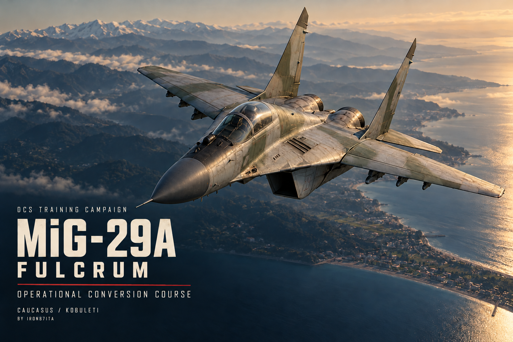
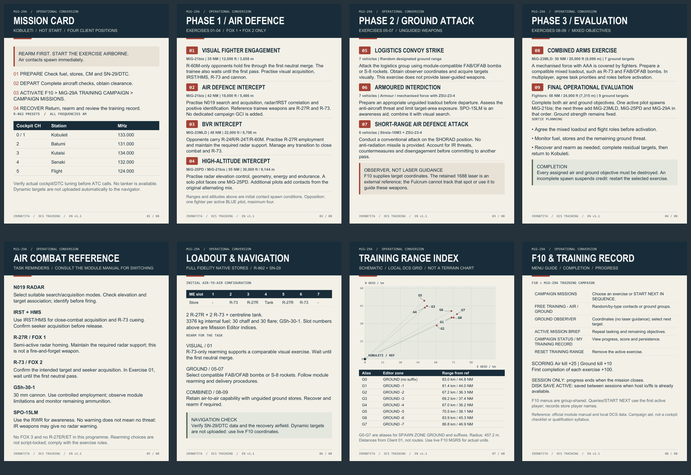

# DCS MIG 29A Dynamic Training Campaign



An English-language **DCS: MiG-29A Fulcrum Full Fidelity** dynamic training campaign, adapted from **Iron87Ita's Mirage F1 Training Campaign**. Fly nine selectable exercises in one `.miz`, from visual air combat and interception to conventional ground attack and combined evaluation.

## Downloads

- **[Campaign v1.1 EN](dist/MiG29A_FF_Operational_Conversion_EN_v1.1.miz)** - ready-to-use mission with cover and all eight kneeboard cards embedded.
- [English kneeboard PDF](docs/MiG29A_FF_Kneeboard_EN.pdf) - printable reference.
- [Optional kneeboard PNG pack](dist/MiG29A_FF_Kneeboard_EN_PNG.zip).
- [Campaign cover](assets/cover.png).

## Requirements and installation

1. DCS World with the **MiG-29A Fulcrum Full Fidelity** module and **Caucasus** terrain.
2. Download the `.miz` above and place it in your Saved Games/DCS `Missions` folder, or open it directly in the Mission Editor.
3. Choose one of the four HOT Client positions at Kobuleti. The cover and kneeboard are already included; no separate installation of the PNG pack is needed for this mission.
4. Read the briefing, rearm on the ground and depart. Start an exercise **when ready airborne** through **F10 > MiG-29A TRAINING CAMPAIGN > CAMPAIGN MISSIONS**. Air contacts spawn immediately relative to the requesting flight.

This is a dynamic single-mission campaign, rather than a `.cmp` containing nine separate mission files. The trainee aircraft use DCS type `MiG-29 Fulcrum`; legacy `MiG-29A` entries are AI opposition.

## Training syllabus

| Exercise | Task | Initial opposition / objectives |
| --- | --- | --- |
| 01 | Visual Fighter Engagement | MiG-21bis, R-60M only; neutral first merge |
| 02 | Air Defence Intercept | MiG-21bis |
| 03 | BVR Intercept | MiG-23MLD |
| 04 | High-Altitude Intercept | MiG-25PD / MiG-21bis sequence |
| 05 | Logistics Convoy Strike | Seven ground vehicles |
| 06 | Armoured Interdiction | Seven vehicles, including ZSU-23-4 protection |
| 07 | Short-Range Air Defence Attack | Six vehicles, including Strela-10M3 and ZSU-23-4 |
| 08 | Combined Arms Exercise | MiG-23MLD cover and seven ground vehicles |
| 09 | Final Operational Evaluation | Mixed fighter sequence and nine ground vehicles |

Air opposition scales one-for-one with active BLUE pilots, up to four; ground strength remains fixed. A solo pilot faces a MiG-25PD in Exercise 04 and a MiG-21bis in Exercise 09. All ground scenarios use the original eight designated clear-area zones, selected randomly.

## Aircraft and exercise rules

- Initial stores: **2 R-27R + 2 R-73 + centreline tank**, GSh-30-1, 3376 kg internal fuel, 30 chaff and 30 flare.
- FOX 1 / FOX 2 programme: no FOX 3 or R-27ER/ET. Manual rearming is not script-locked; follow the exercise rules.
- Conventional ground attack uses compatible FAB/OFAB bombs or S-8 rockets. Mixed sorties may require recovery and ground rearming.
- No tanker is provided. The retained ground observer supplies coordinates; its 1688 laser is not a spot the Fulcrum can track or use to guide these weapons.
- R-862: cockpit CH0/CH1 Kobuleti 133.000 AM; CH2 Batumi 131.000; CH3 Kutaisi 134.000; CH4 Senaki 132.000; CH5 flight 124.000.

## Kneeboard



Eight 1536 x 2048 cards cover the mission workflow, radio presets, all nine exercises, air combat reminders, initial stores, navigation, a range schematic and F10 training records. The schematic uses DCS local grid coordinates and distances from Client 01. It is not a terrain chart or a geographic bearing solution; use live F10 MGRS for actual target positions.

## Scoring and persistence

Air kill: +25. Ground kill: +10. First completion of each exercise: +100. An incomplete spawn suspends completion credit. All assigned air/ground objectives must be destroyed; landing, identification and airmanship are not automatically graded.

The dedicated progress path is `Saved Games/DCS/Missions/Saves/MiG29ATrainingFF/progress.dat`. Cross-session saving works only if host `io/lfs` access is already available. The normal DCS sandbox retains progress for the current session only. The campaign changes no host configuration files.

F10 menus remain shared at flight-group level. Record queries and START NEXT use the first active player in that group, while kill and completion records are stored by player name.

## Repository contents

| Path | Contents |
| --- | --- |
| `dist/` | Ready-to-use mission and optional PNG package |
| `assets/` | English cover, preview and individual kneeboard pages |
| `docs/` | PDF, usage notes, validation report and ImageGen prompts |
| `mission/` | Editable mission archive contents, excluding duplicated artwork |
| `tools/` | Packaging, validation, Lua-data parser and kneeboard authoring tools |
| `tests/` | DCS API mock tests used for the English mission |

### Rebuild and validate

With Python 3.10 or newer:

```sh
python tools/pack_mission.py --output dist/rebuilt.miz
python tools/validate_mission.py dist/rebuilt.miz
```

To regenerate the kneeboard PDF/PNGs, install `tools/requirements.txt` and run `python tools/build_kneeboard.py --help`. The original layout uses Windows Arial, Arial Narrow and Consolas; these fonts are not bundled. Mock-test scripts can run with a compatible Lua 5.1 interpreter; see [test instructions](tests/README.md).

## Validation status

Archive CRC, resource references, four FF Client positions, Lua compilation, all eight kneeboard pages and unchanged scenario geometry/weather/triggers were checked. All nine exercises passed simulated API tests with one and four pilots, including the original two-flight multiplayer layout. Rendered cards were visually inspected.

**In-simulator and in-flight validation remains outstanding.** Mock checks do not validate cockpit behaviour, AI behaviour, graphics display or flight performance. See the [validation report](docs/VALIDATION.txt).

## Credits and references

Original campaign: **Iron87Ita**. Personal MiG-29A Full Fidelity conversion and English graphic edition. The cover was made with built-in ImageGen; the kneeboard is deterministically typeset. The cover is aviation artwork, not a DCS screenshot. This is not an official Eagle Dynamics campaign.

- [Official MiG-29A Fulcrum module](https://www.digitalcombatsimulator.com/en/shop/modules/fulcrum/)
- [Official Early Access manual](https://www.digitalcombatsimulator.com/upload/iblock/aa2/ulzl67k42kj99ushy9m29hlvmtk0y2tg/DCS%20MiG-29A%20Early%20Access%20Manual%20EN.pdf)
- Local module data and the supplied campaign were used to verify stores, radio channel indices and range positions. No DCS module binaries or commercial font files are included.
